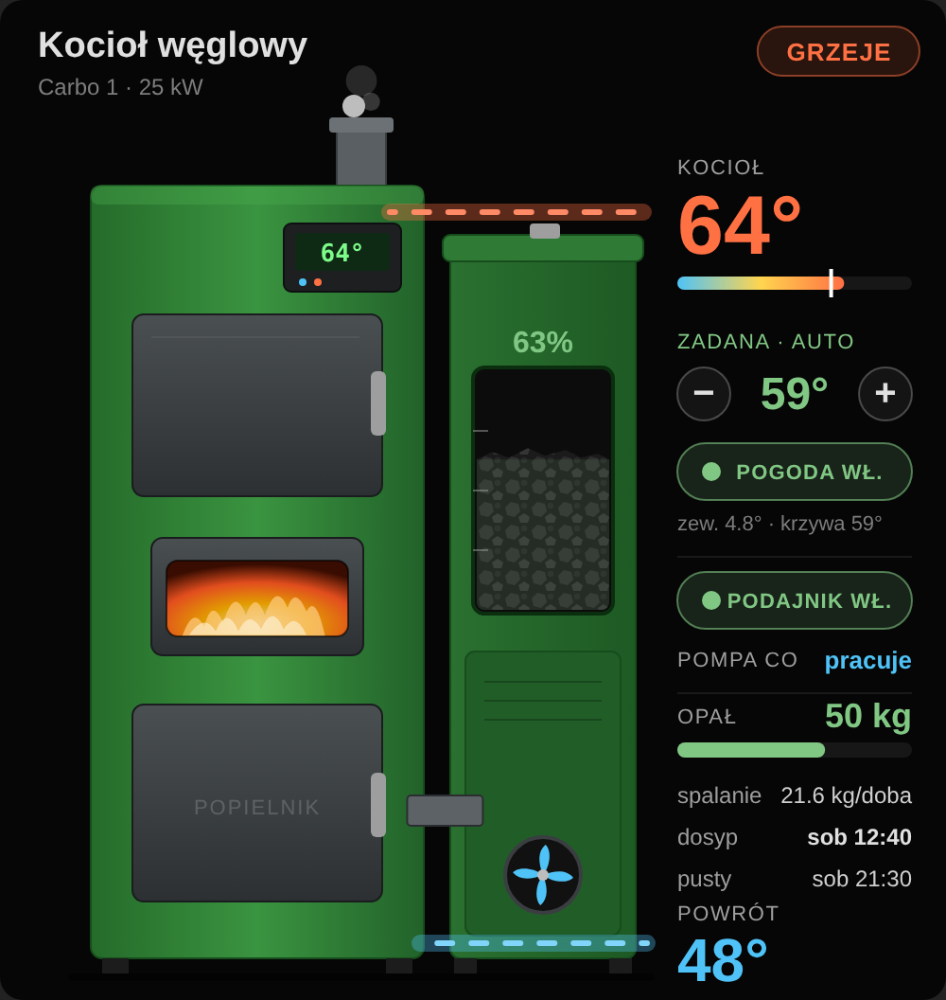

# Compit MULTI 765 (iNext) – Home Assistant

Nieoficjalna integracja Home Assistant dla sterowników kotłów **Compit MULTI 765 / 765G**
podłączonych do chmury **Compit iNext** (bramka iNext). Odczyt pełnego stanu kotła,
bezpieczny zapis wybranych nastaw oraz opcjonalne **sterowanie pogodowe** liczone w HA.

> ⚠️ Projekt niezależny, niezwiązany z firmą Compit. Używasz na własną odpowiedzialność.
> Zmiana nastaw kotła na paliwo stałe może wpłynąć na jego pracę i bezpieczeństwo –
> zawsze kieruj się instrukcją (DTR) swojego kotła.

  

Przykładowy panel zbudowany na encjach integracji: temperatura kotła i powrotu,
zadana z przyciskami −/+, sterowanie pogodowe, podajnik, opał w kg, spalanie i termin dosypania.

## Funkcje

- **Czujniki:** temperatura kotła, temperatura powrotu, poziom paliwa (%), stan pomp CO/CWU,
  diagnostyczna lista wszystkich parametrów sterownika (~119).
- **Nastawy (zapis):** temperatura zadana kotła, obroty wentylatorów (PID moc MAX/MIN,
  wentylator 2), czasy cyklu, podtrzymanie, temperatura powrotu MIN, histereza,
  przejście w podtrzymanie, pojemność zasobnika, praca z podajnikiem.
  - Zakresy są celowo **węższe** niż w sterowniku.
  - Przed zapisem sprawdzane są reguły z DTR (np. moc MAX > moc MIN, czas cyklu Pmin ≥ Pmax + 60 s).
- **Przycisk „Odśwież ze sterownika”** – odpowiednik „Pobierz grupę” w panelu iNext.
- **Sterowanie pogodowe (opcjonalne):**
  `zadana = zadana przy 0 °C − nachylenie × T_zew (średnia 2 h)`, w granicach min–max,
  z obniżeniem wg dowolnej encji (harmonogram, input_boolean…) i korektą od termostatów.
  Zapis do sterownika tylko przy zmianie ≥ 2 °C i nie częściej niż co 30 min.
- **Opał:** węgiel w zasobniku (kg), średnie spalanie (kg/h, kg/doba), termin dosypania
  i moment opróżnienia zasobnika – liczone w HA od ostatniego dosypania, więc prognoza nie „pływa”.
  Pojemność zasobnika uczy się sama po wpisaniu, ile kg dosypano.
- **Ponowne logowanie** po zmianie hasła, **diagnostyka** bez danych logowania,
  usługa `compit_multi765.dump_parameters`.

## Instalacja

### Katalog społeczności (Home Assistant 2026.11 i nowsze)
1. **Ustawienia → Katalog społeczności.** Przy pierwszym otwarciu przeczytaj i zaakceptuj komunikat.
2. Połącz konto GitHub w katalogu – bez tego nie da się dodać repozytorium z linku.
3. **Dodaj z linku** → wklej `https://github.com/xtronets/ha-compit-multi765`.
4. Zainstaluj **Compit MULTI 765 (iNext)** i zrestartuj Home Assistant.

### HACS (Home Assistant 2026.10 i starsze)
1. HACS → ⋮ → *Custom repositories* → `https://github.com/xtronets/ha-compit-multi765`, typ *Integration*.
2. Zainstaluj **Compit MULTI 765 (iNext)** i zrestartuj Home Assistant.

Jeśli integracja była zainstalowana przez HACS, po aktualizacji do 2026.11 zostanie
automatycznie przeniesiona do katalogu społeczności.

### Ręcznie
Skopiuj katalog `custom_components/compit_multi765` do `config/custom_components/`
i zrestartuj Home Assistant.

## Konfiguracja

1. **Ustawienia → Urządzenia i usługi → Dodaj integrację → Compit MULTI 765.**
2. Zaloguj się tym samym kontem co na `inext.compit.pl` i wybierz sterownik.
3. (Opcjonalnie) **Konfiguruj** przy integracji – wybierz **własne** encje:

| Opcja | Co wybrać |
|---|---|
| Temperatura zewnętrzna | dowolny czujnik temperatury **lub** encja pogody (`weather.*`); °F przeliczane na °C |
| Źródło zapasowe | drugi czujnik / pogoda, gdy główne jest niedostępne |
| Encja obniżenia | np. pomocnik **Harmonogram** (`schedule.*`), `input_boolean`, `binary_sensor`, `switch` – stan `on` = obniżenie |
| Termostaty | encje `climate.*` (np. Better Thermostat, TRV); liczy się `hvac_action: heating` |

Bez czujnika zewnętrznego przełącznik **Sterowanie pogodowe** nie da się włączyć,
a reszta integracji działa normalnie.

### Nastawy krzywej (encje w sekcji *Konfiguracja* urządzenia)

| Encja | Domyślnie | Opis |
|---|---|---|
| Krzywa: zadana przy 0 °C | 62 °C | punkt odniesienia krzywej |
| Krzywa: nachylenie | 0,6 | o ile °C rośnie zadana na każdy 1 °C mrozu |
| Krzywa: minimum | 58 °C | twarda dolna granica (także po obniżeniu i korekcie) |
| Krzywa: maksimum | 72 °C | górna granica |
| Obniżenie wg harmonogramu | 3 °C | gdy encja obniżenia = `on` |
| Korekta od głowic | 2 °C | −, gdy ≤ 1 termostat grzeje przez 15 min; +, gdy ≥ 60 % grzeje przez 30 min |

Encja **Zadana wyliczona (pogodowa)** pokazuje wynik krzywej także przy wyłączonym
sterowaniu – możesz najpierw obserwować, potem włączyć.

## Opał i kalibracja zasobnika

Sterownik zna tylko **poziom paliwa w %**. Liczy go z czasu pracy podajnika
i parametru **„Pojemność zasobnika” (minuty)**. Integracja dokłada do tego:

| Encja | Opis |
|---|---|
| Węgiel w zasobniku | kg = poziom % × pojemność zasobnika (kg) / 100 |
| Średnie spalanie | kg/h od ostatniego dosypania; atrybuty: %/h, kg/doba, źródło |
| Termin dosypania | kiedy poziom spadnie do progu dosypania |
| Zasobnik pusty | kiedy poziom spadnie do 0 % |
| Pojemność zasobnika (kg) | ile węgla mieści pełny zasobnik (konfiguracja) |
| Próg dosypania | domyślnie 10 % (konfiguracja) |
| Dosypano węgla | wpisz, ile kg dosypałeś – służy do kalibracji |

**Jak to działa**
- Dosypanie jest wykrywane samo, gdy poziom w sterowniku skoczy o co najmniej 10 pkt %.
  Od tej chwili liczone jest nowe średnie spalanie.
- Przez pierwsze 6 h po dosypaniu używane jest spalanie z poprzedniego cyklu
  (przy pierwszym uruchomieniu: wartość domyślna 1,2 %/h).

**Kalibracja – krok po kroku**
1. Ustaw **Pojemność zasobnika (kg)** na przybliżoną wartość (np. liczba worków × 20 kg).
2. Przy każdym dosypaniu: dosyp węgiel, ustaw w sterowniku poziom zasobnika
   (tak jak zwykle), a potem w HA wpisz w **Dosypano węgla** ile kg wsypałeś.
   Kolejność nie ma znaczenia – wpis czeka do 6 h na skok poziomu i odwrotnie.
3. Integracja porówna kg ze wzrostem poziomu w % i poprawi pojemność zasobnika
   (pierwszy pomiar wprost, kolejne uśredniane). Po 2–3 dosypaniach prognoza jest dokładna.

**Dostrojenie sterownika („Pojemność zasobnika” w minutach)**
- Sterownik pokazuje 0 %, a w zasobniku jest jeszcze węgiel → **zwiększ** minuty.
- Węgiel kończy się, zanim sterownik pokaże 0 % → **zmniejsz** minuty.
- Zmieniaj o 5–10 % i obserwuj przez pełny cykl zasobnika. Dopiero gdy sterownik
  trafia w „pusty”, kalibracja kg w HA ma sens.

## Uwagi techniczne

- Odczyt podstawowy co 2 min (API mobilne iNext), pełny stan co 10 min (panel WWW iNext).
- Zmiana nastawy trafia do sterownika przez chmurę z opóźnieniem ok. 1–2 min.
- Testowane na: Compit MULTI 765G + kocioł Kotrem Carbo 1 (podajnik szufladowy, ekogroszek).
  Inne sterowniki iNext mogą mieć inne kody parametrów – zgłoś zrzut z usługi
  `dump_parameters` w Issues.

## Licencja

MIT
